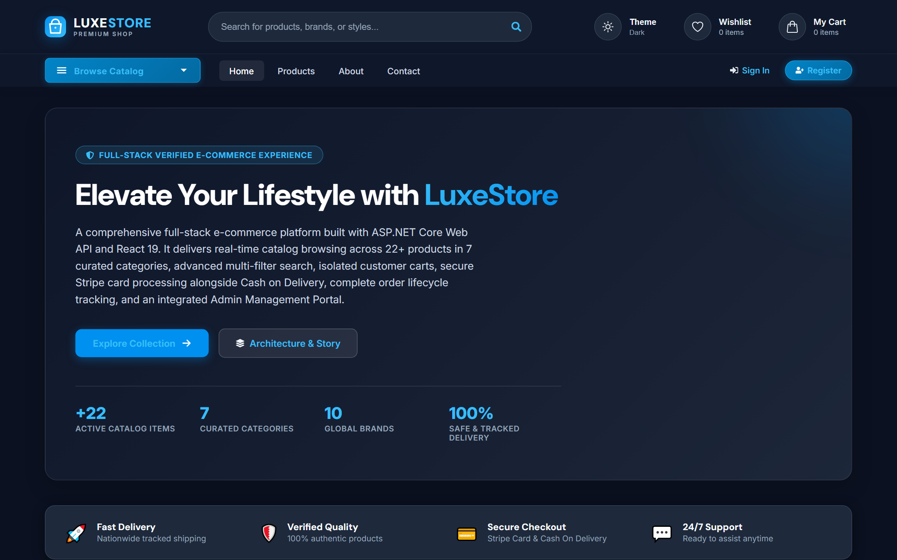
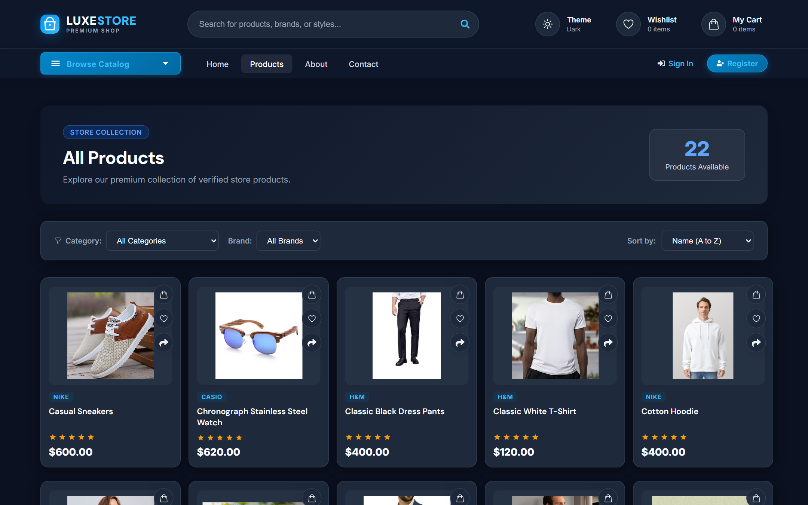
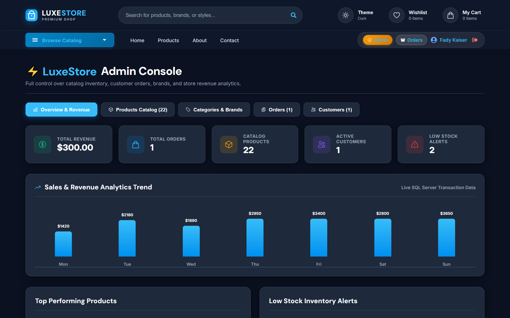
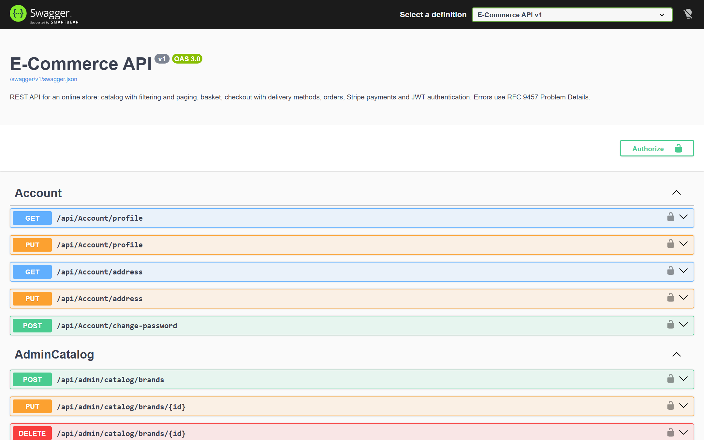

<div align="center">


</div>

<div align="center">

[](https://ecommerce-full-stack-nine.vercel.app)
[](https://ecommercesolution.runasp.net/swagger/index.html)
[](https://github.com/Fady519/Ecommerce-FullStack)
[](https://www.linkedin.com/in/fady-kaiser/)
[](https://fady519.github.io/MyPortfolio2/)

</div>

---

<div align="center">

## 🛍️ An enterprise full-stack E-Commerce platform — not just CRUD.
**Clean Onion Architecture · ASP.NET Core 10 Web API · React 19 · Redis Caching · Stripe Payments · Role-Based Access Control · Admin Intelligence Portal**  
Built to handle high-throughput modern retail operations with enterprise-level code quality and seamless user experience.

</div>

---

## 🖥️ Live Preview

<div align="center">

> 🔗 **Storefront:** [ecommerce-full-stack-nine.vercel.app](https://ecommerce-full-stack-nine.vercel.app)  
> 🔗 **Swagger API Docs:** [ecommercesolution.runasp.net/swagger](https://ecommercesolution.runasp.net/swagger/index.html)

</div>

### 1. Modern Storefront & Dynamic Catalog


### 2. Multi-Filter Catalog, Live Search & Sorting


### 3. Integrated Admin Console & Inventory Intelligence


### 4. Interactive Swagger OpenAPI Specification (Live on MonsterASP)


---

## ✨ Features

| Feature | Description |
|---|---|
| 🏗️ **Clean Onion Architecture** | Strict separation of concerns across Domain, Persistence, Services, and Presentation layers |
| 🔐 **Role-Based Access Control (RBAC)** | ASP.NET Identity with JWT Bearer tokens and claims-based authorization for `Admin` and `Customer` |
| ⚡ **Redis Basket & Output Caching** | Distributed Redis caching for high-speed cart persistence and tag-evicted output caching |
| 📊 **Admin Intelligence Dashboard** | Real-time aggregation of store revenue, sales volume, order lifecycle tracking, and low-stock alerts |
| 🏷️ **Dynamic Multi-Filter Catalog** | Paginated catalog with multi-category filtering, brand selection, price sorting, and live search |
| 🛒 **Isolated User Basket & Wishlist** | Strict user-token key isolation preventing cross-session cart and favorites leakage |
| 💳 **Secure Payment Processing** | Dual-mode checkout supporting live **Stripe** card payments and Cash on Delivery |
| 📦 **Order Lifecycle & Address Management** | Atomic order creation, delivery tier selection, shipping address capture, and history tracking |
| 🌓 **Adaptive Dark / Light Theme** | Luxury modern UI theme engine with zero-flicker persistent user preferences |
| 🎭 **Automated Testing Suite** | Comprehensive Vitest unit/component suite + Playwright automated end-to-end testing |

---

## 🏗️ Architecture & System Design

The backend is built following strict **Clean / Onion Architecture** principles with repository patterns and specifications:

```
┌────────────────────────────────────────────────────────┐
│               Presentation Layer                       │
│    ASP.NET Core 10 Web API · REST Controllers          │
│    JWT Authentication Middleware · RFC 9457 Errors     │
└───────────────────────────┬────────────────────────────┘
                            │
┌───────────────────────────▼────────────────────────────┐
│                Services Layer                          │
│    Business Services · AutoMapper · Specifications     │
│    Image Upload Service · Dashboard Analytics          │
└───────────────────────────┬────────────────────────────┘
                            │
┌───────────────────────────▼────────────────────────────┐
│              Persistence Layer                         │
│    StoreDbContext · EF Core Migrations · SQL Server    │
│    JSON Data Seeders · Unit of Work · Redis Store      │
└───────────────────────────┬────────────────────────────┘
                            │
┌───────────────────────────▼────────────────────────────┐
│                Domain Layer                            │
│    Entities (Product, Brand, Type, Order, Basket)      │
│    Value Objects · Repository Contracts · Enums        │
└────────────────────────────────────────────────────────┘
```

---

## 👥 User Roles & Access Control

| Role | Permissions & Access Scope |
|---|---|
| **Administrator** | Full access to **Admin Console** (`/admin`): Add/edit/delete products, manage brands & categories, quick stock adjustments (`+`/`-`), view order lifecycle & sales analytics |
| **Customer** | Full shopping experience: Add to cart, manage wishlist, complete checkout via Stripe or Cash on Delivery, and track personal orders (`/orders`) |
| **Visitor / Guest** | Browse catalog, filter categories, search products, read journal, toggle light/dark theme (Prompted to login for cart & checkout) |

> ⚡ **Demo Experience:** The login page includes **1-Click Demo Buttons** (`⚡ Login as Admin` and `⚡ Login as Customer`) allowing recruiters and visitors to test all roles instantly without typing credentials!

---

## 📊 Admin Intelligence & Revenue Analytics

The integrated **Admin Console** surfaces real-time store metrics directly from the database:

```
✦ Total Revenue ($) & Total Orders Volume
✦ Low-Stock Alerts & Real-time Inventory Warnings
✦ One-Click Quick Stock Increments / Decrements
✦ Catalog Item Management (Image Upload, Pricing, Categories, Brands)
✦ Customer Orders Status Management (Pending, Payment Received, Shipped)
```

> Replaces static management with live, reactive administration.

---

## 🛠️ Tech Stack

<div align="center">

### Backend & Database


### Architecture & Patterns


### Frontend & Styling


### Testing & Quality Assurance


</div>

---

## 📁 Repository Structure

```
Project_5_Ecommerce/
│
├── E-commerce.Domain/               # Core business entities, contracts & repository interfaces
├── E-commerce.Persistence/          # DbContext, migrations, seeders, repository implementations
├── E-commerce.Services/             # Application logic, DTO mapping, specifications, image service
├── E-commerce.ServicesAbstraction/  # Service contracts & interfaces
├── E-commerce.Presentation/         # REST API Controllers (Catalog, Admin, Orders, Basket, Auth)
├── E-commerce.Shared/               # DTOs, query parameters, unified API responses
├── E-Commerce.Web/                  # API host Composition Root, DI registration, Swagger & Middleware
│
├── ecommerce-web/                   # Frontend SPA (React 19 + Vite)
│   ├── src/
│   │   ├── components/              # Headers, modals, sliders, UI controls, Context providers
│   │   ├── page/                    # Home, Catalog, Product Details, Cart, Admin, Checkout, Orders
│   │   ├── services/                # Strongly-typed API client (universal fetch wrapper)
│   │   └── test/                    # Unit and component tests (Vitest)
│   └── e2e/                         # Playwright automated End-to-End user journeys
│
├── docs/                            # Architectural documentation, roadmap & live screenshots
└── scripts/                         # Database population, SQL seeding & helper scripts
```

---

## 🚀 Getting Started

### Prerequisites
- [.NET 10 SDK](https://dotnet.microsoft.com/download)
- [Node.js (v18+) & npm](https://nodejs.org/)
- SQL Server (LocalDB, SSMS, or MonsterASP)

### 1. Backend Setup
```bash
# 1. Clone the repository
git clone https://github.com/Fady519/Ecommerce-FullStack.git
cd Ecommerce-FullStack

# 2. Restore dependencies & run backend API
dotnet restore
dotnet run --project E-Commerce.Web

# The API will be live at http://localhost:5163 with Swagger at /swagger
```

### 2. Frontend Setup
```bash
# 1. Navigate to frontend
cd ecommerce-web

# 2. Install dependencies
npm install

# 3. Launch Vite development server
npm run dev

# The storefront will be live at http://localhost:5173
```

---

## 🔑 Default Credentials & Demo Access

| Role | Email | Password | Access Highlights |
|---|---|---|---|
| **Administrator** | `fadykaiser2004@gmail.com` | `Fady@Store2026` | Full Admin Console, Analytics, Product Management |
| **Demo Customer** | `fady@demo.store` | `Pa$$w0rd123` | Cart, Wishlist, Checkout, Order Tracking |

> 💡 **Tip:** On the live website login screen, simply click the **1-Click Demo Buttons** to sign in instantly without typing anything!

---

## 🧪 Automated Testing

```bash
cd ecommerce-web

# Run Vitest unit & component tests
npm run test

# Run Playwright E2E scenarios (Storefront, Cart, Checkout, Admin flow)
npm run test:e2e

# Run all test suites combined
npm run test:all
```

---

<div align="center">

[](https://www.linkedin.com/in/fady-kaiser/)
[](https://github.com/Fady519)
[](https://fady519.github.io/MyPortfolio2/)


**⭐ If this project impressed you, drop a star on GitHub — it means a lot!**

</div>
