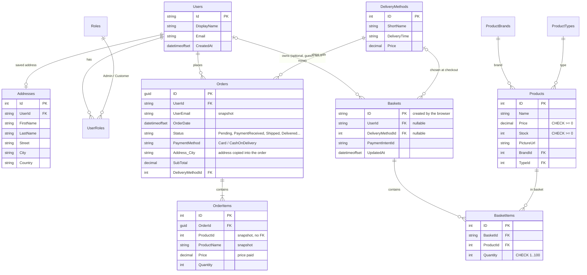

<div align="center">


</div>

<div align="center">

[](http://ecommercesolution.runasp.net/swagger/index.html)
[](https://github.com/Fady519/E_CommerceSolution)
[](https://www.linkedin.com/in/fady-kaiser/)

</div>

---

<div align="center">

## ⚙️ A production-grade E-Commerce API — built the right way.

Onion Architecture. Generic Repository. Redis Caching. Stripe Payments. JWT Auth.  
Every layer clean. Every endpoint secured. Every response standardized.

</div>

---

## 🖥️ API Explorer

<div align="center">

> 📄 **[Explore via Swagger UI](http://ecommercesolution.runasp.net/swagger/index.html)**

> _Add a Swagger UI screenshot here_

</div>

---

## ✨ Core Capabilities

| Capability | Detail |
|---|---|
| 🏗️ **Onion Architecture** | Domain → Application → Persistence — zero cross-layer leakage |
| 🗃️ **Generic Repository + Specification Pattern** | ~40% less code duplication across all data-access modules |
| ⚡ **Output Caching** | Catalog responses cached in memory (per query string) — no Redis server needed |
| 🔐 **JWT Bearer Auth** | Stateless authentication with ASP.NET Identity and claims-based RBAC |
| 💳 **Stripe Integration** | Full payment lifecycle — intent creation, confirmation, webhook handling |
| 🛡️ **Custom Middleware** | Centralized exception handling + standardized API response envelope |
| 📄 **Swagger / OpenAPI** | Fully documented and interactively testable endpoints |
| 🔄 **Async Pipeline** | `async/await` throughout — maximum throughput, zero thread blocking |

---

## 🏗️ Architecture

```
┌──────────────────────────────────────────────┐
│                   API Layer                  │
│   Controllers · Middleware · Swagger         │
│   JWT Config · Exception Handler             │
└─────────────────────┬────────────────────────┘
                      │
┌─────────────────────▼────────────────────────┐
│              Application Layer               │
│   Services · DTOs · AutoMapper Profiles      │
│   Stripe Service · Interfaces                │
└─────────────────────┬────────────────────────┘
                      │
┌─────────────────────▼────────────────────────┐
│              Persistence Layer               │
│   EF Core · Generic Repository               │
│   Specification Pattern · Redis Cache        │
└─────────────────────┬────────────────────────┘
                      │
┌─────────────────────▼────────────────────────┐
│                Domain Layer                  │
│   Entities · Interfaces · Business Rules     │
└──────────────────────────────────────────────┘
```

---

## 🗄️ Database

One SQL Server database (`ECommerceStore`) holds everything: users & roles (ASP.NET Identity), the catalog, baskets and orders.
Baskets used to live in Redis and users in a second database; now every relationship is a real foreign key.



**Design choices**
- **Prices are never stored in the basket** — they are read from `Products`, so a client can't send a cheaper price.
- **Orders keep snapshots** (product name, price paid, address, email): editing a product or an address later doesn't rewrite order history. That's why `OrderItems.ProductId` has no foreign key.
- **Deleting is safe**: removing a user or a delivery method that has orders is refused (`Restrict`); basket lines are removed with their basket (`Cascade`).
- **Readable data**: order status and payment method are stored as text (`"Delivered"`, not `3`), and Identity tables have short names (`Users`, `Roles`).
- **Seeding**: the catalog (13 products, 6 brands, 4 types, 4 delivery methods in EGP) is seeded on first start from JSON files embedded in the dll. `--seed-demo` adds 30 customers and ~3 months of orders (see below).

---

## 🛠️ Tech Stack

<div align="center">


**Patterns & Architecture**


</div>

---

## 🔌 API Endpoints

| Method | Endpoint | Auth | Description |
|---|---|---|---|
| `POST` | `/api/account/register` | ❌ | Register new user |
| `POST` | `/api/account/login` | ❌ | Login & get JWT |
| `GET` | `/api/products` | ❌ | Get all products (cached) |
| `GET` | `/api/products/{id}` | ❌ | Get product details |
| `GET` | `/api/basket` | ✅ | Get user basket |
| `POST` | `/api/basket` | ✅ | Add item to basket |
| `POST` | `/api/orders` | ✅ | Place an order |
| `POST` | `/api/payments` | ✅ | Create Stripe payment intent |

> Full interactive docs available on **[Swagger UI](http://ecommercesolution.runasp.net/swagger/index.html)**

---

## 💳 Stripe Payment Flow

```
1. Client sends POST /api/payments
         ↓
2. API creates PaymentIntent via Stripe SDK
         ↓
3. Client confirms payment on frontend
         ↓
4. Stripe fires webhook → API updates order status
         ↓
5. Order confirmed ✅
```

---

## ⚙️ Getting Started

### Prerequisites

- [.NET 10 SDK](https://dotnet.microsoft.com/download)
- SQL Server (LocalDB / Express / Developer) — no Redis needed anymore
- A Stripe account in **test mode** (only for card payments)

### Installation

```bash
# 1. Clone the repo
git clone https://github.com/Fady519/E_CommerceSolution.git
cd E_CommerceSolution

# 2. Secrets (never in appsettings.json) — stored outside the repo with user-secrets
dotnet user-secrets set "JWTOptions:SecretKey" "<a long random string, 32+ characters>" --project E-Commerce.Web
dotnet user-secrets set "Stripe:SecretKey"     "sk_test_..."                          --project E-Commerce.Web
dotnet user-secrets set "AdminUser:Password"   "<password for the admin account>"     --project E-Commerce.Web
dotnet user-secrets set "DemoData:Password"    "<password for the demo logins>"       --project E-Commerce.Web

# 3. Run — in Development the database (ECommerceStore on Server=.) is created, migrated and seeded automatically
dotnet run --project E-Commerce.Web --launch-profile http

# 4. (optional) Demo data: 30 customers + ~3 months of orders
dotnet run --project E-Commerce.Web --launch-profile http -- --seed-demo
```

Swagger: `http://localhost:5163/swagger`. Demo logins: `customer@demo.store` and `admin@demo.store` (password = `DemoData:Password`).
The connection string lives in `E-Commerce.Web/appsettings.Development.json` (change `Server=.` if your SQL Server instance has another name).

---

<div align="center">


**⭐ Found this useful? A star keeps the momentum going.**

</div>
